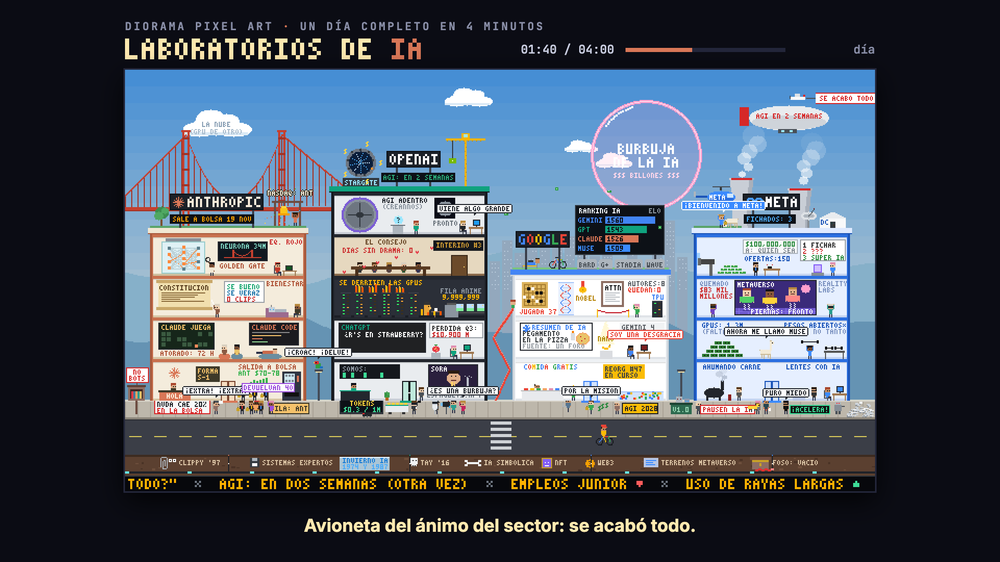

# Diorama: Laboratorios de IA

Un diorama pixel art animado de la calle donde viven los laboratorios de IA: Anthropic, OpenAI, Google y Meta. Fichajes en helicóptero, lanzamientos cada 30 segundos, códigos rojos, GPUs derretidas y una burbuja que crece hasta reventar.

**Verlo en vivo: https://israads.github.io/diorama-labs-ia/**

## Cómo está hecho

- Un solo archivo, `index.html`. Sin dependencias, sin imágenes y sin fuentes externas.
- Todo se dibuja en un canvas de 720x405, rectángulo por rectángulo, con una fuente bitmap de 3x5 hecha a mano.
- Cada cuadro es función pura del tiempo, así que el bucle de 240 segundos (con su día y su noche) se repite exacto.

## Controles

| Acción | Tecla |
|---|---|
| Lupa | clic sobre el diorama |
| Pausa | espacio |
| Saltar 10 s | flechas izquierda y derecha |
| Subtítulos | G |
| Pantalla completa | F |

En la URL: `?t=120` empieza en ese segundo, `?pause` arranca en pausa y `?noguide` oculta los subtítulos.

## Aviso

Es una sátira. No es una fuente de noticias: los titulares, las cifras y los nombres de modelos son parte del chiste.
